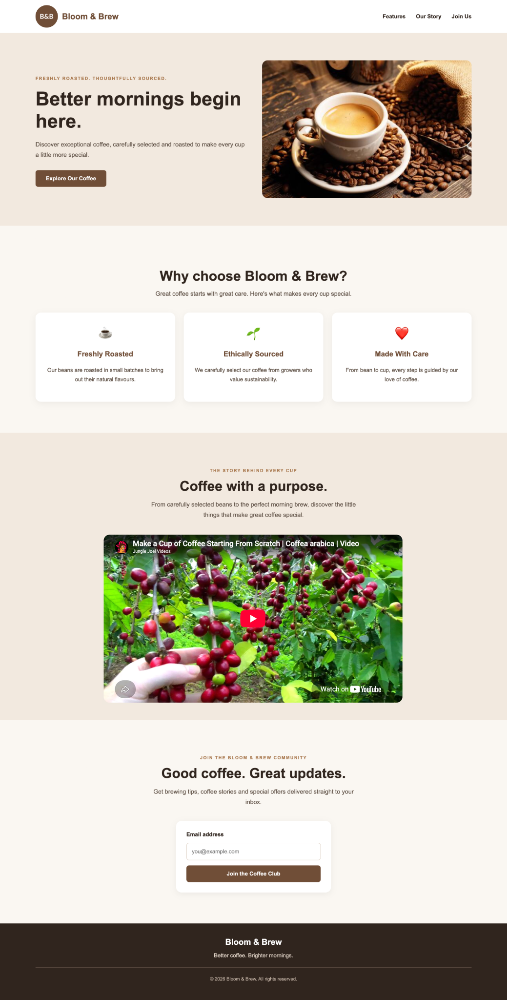

# ☕ Bloom & Brew — Product Landing Page

A responsive product landing page for **Bloom & Brew**, a fictional specialty coffee brand.

Built as part of the [freeCodeCamp Responsive Web Design](https://www.freecodecamp.org/learn/2022/responsive-web-design/) curriculum to practise HTML5, CSS3, responsive layouts and front-end development fundamentals.

## 🌐 Live Demo

[**View the live website**](https://mepopis.github.io/bloom-and-brew/)

## 📸 Website Preview




## ✨ Features

- Responsive layout designed for desktop, tablet and mobile screens
- Sticky navigation with smooth scrolling between sections
- Reduced-motion support for improved accessibility
- Hero section with coffee imagery and a call-to-action link
- Three feature cards highlighting the brand's selling points
- Embedded YouTube video
- Email subscription form with built-in HTML5 validation
- Branded footer with a custom divider

## 🛠️ Technologies Used

- **HTML5** — semantic structure, navigation, forms and embedded media
- **CSS3** — styling, Flexbox, media queries and responsive design
- **Git** — local version control and commit history
- **GitHub** — source code hosting
- **GitHub Pages** — static website deployment
- **VS Code** — development environment

## 📱 Responsive Design

The website uses CSS Flexbox and media queries to adapt its layout to different viewport widths.

At **768px and below**, the hero section and feature cards change from horizontal to vertical layouts.

At **480px and below**, typography, image dimensions and spacing are further adjusted for smaller mobile screens.

## ♿ Accessibility Considerations

- Semantic HTML elements and logical heading structure
- Descriptive alternative text for images
- Associated label for the email input
- Visible focus styling for the form input
- Reduced-motion support for smooth scrolling

## 🧪 Testing

The project successfully passed **all 25 freeCodeCamp Product Landing Page tests**.

The layout was also checked using browser developer tools and on a mobile device.

## 🐛 Challenges and Lessons Learned

### HTML Nesting and Flexbox

During development, a missing closing `</section>` tag caused multiple page sections to become children of the hero's Flexbox container.

This resulted in unexpected horizontal positioning and an image rendered at zero width.

Correcting the HTML structure resolved the issue without requiring changes to the CSS.

### Mobile Navigation

Anchor navigation initially caused an abrupt visual jump on mobile.

Adding smooth scrolling improved the experience, while a `prefers-reduced-motion` media query provided an alternative for visitors who prefer less animation.

### External Video Embedding

Embedding a YouTube video highlighted the difference between valid iframe markup and external playback restrictions.

## 🚀 Running the Project Locally

1. Clone the repository:

   ```bash
   git clone https://github.com/mePopis/bloom-and-brew.git
   ```

2. Open the `bloom-and-brew` folder in VS Code.

3. Open `index.html` in a browser.

No build tools or dependencies are required.

## 📚 What I Learned

This project helped me develop a practical understanding of:

- Structuring webpages with semantic HTML
- Building layouts using CSS Flexbox
- Creating responsive designs with media queries
- Using built-in HTML5 form validation
- Debugging HTML nesting and layout problems
- Testing websites on different screen sizes
- Managing code changes with Git and GitHub
- Publishing static websites with GitHub Pages

## 📌 Future Improvements

- Complete a more thorough accessibility audit
- Review external video playback compatibility
- Add a screenshot of the finished website
- Connect the subscription form to a working mailing list service

---

**Project status:** Completed — 25/25 freeCodeCamp tests passed.

*Created as a learning and portfolio project.*
